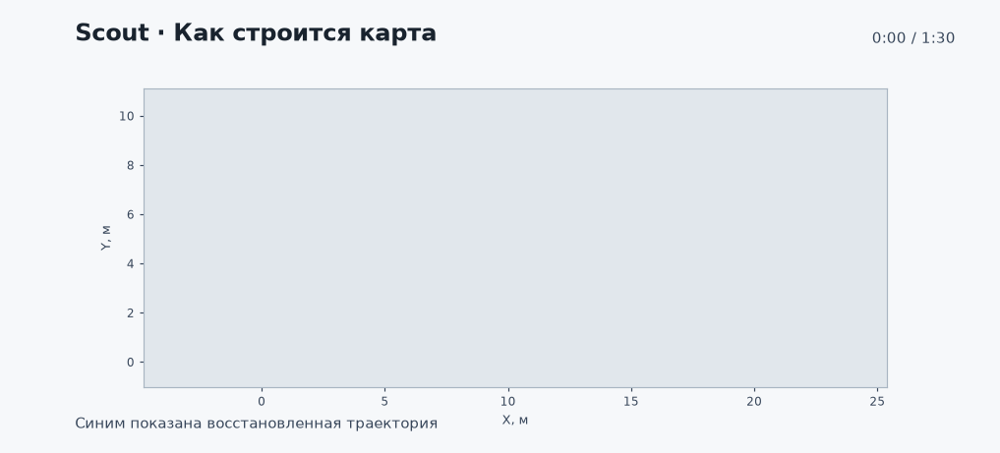

# JetBot с ROS 2 для МФТИ

Комплект программ на ROS 2 для дифференциального робота JetBot с автономной навигацией. Проект предназначен для учебных и исследовательских задач МФТИ.

## Обзор

В проект входят следующие компоненты:
- Аппаратный интерфейс дифференциального привода
- Подключение лидара RPLidar
- Автономная навигация Nav2
- Картирование и локализация с помощью SLAM Toolbox
- Управление с геймпада
- Развёртывание в Docker

## Визуализации ЛР 3, ЛР 4 и ДЗ 2

[Код и инструкции курса](coursework/README.md)

### ЛР 3. Одометрия JetBot

Колёсная и лидарная одометрия и результат EKF на одном заезде. [Протокол ЛР 3](coursework/labs/lab03_odometry/results/04-ekf-odometry.md)


### ЛР 4. Локализация на сохранённой карте

Траектория JetBot при повторном объезде стола поверх карты первого заезда. [Протокол ЛР 4](coursework/labs/lab04_mapping/results/03-localization.md)


### ДЗ 2. Построение карты из rosbag

Ускоренное воспроизведение сохранённых состояний SLAM из 90-секундного фрагмента записи Scout. [Итоговая карта и протокол ДЗ 2](coursework/homework/hw02_slam/results/02-full-first-segment.md)



## Требования

- Плата NVIDIA Jetson. Проект проверен на Jetson Nano.
- Docker с поддержкой среды выполнения NVIDIA
- ROS 2 Humble в контейнере Docker
- Подключённые устройства:
  - Моторы JetBot через `/dev/ttyMOTOR`
  - Лидар RPLidar через `/dev/ttyLIDAR`
  - USB-камера через `/dev/video0`
  - Геймпад через `/dev/input/js0`

## Настройка оборудования

### Привязка имён USB-устройств
Перед запуском контейнеров один раз назначьте оборудованию постоянные имена устройств.

```bash
# Выполнить на JetBot вне контейнера Docker
cd general_scripts
sudo ./create_udev_rules.sh
```

Скрипт настраивает устройства:
- Создаёт символические ссылки с постоянными именами.
- Назначает контроллеру моторов с микросхемой CH340 имя `/dev/ttyMOTOR`.
- Назначает RPLidar с микросхемой CP210x имя `/dev/ttyLIDAR`.
- Определяет устройства по идентификаторам производителя и модели USB.

**Правила привязки устройств**
- Моторы с `ATTRS{idVendor}=="1a86", ATTRS{idProduct}=="7522"` получают имя `/dev/ttyMOTOR`.
- Лидар с `ATTRS{idVendor}=="10c4", ATTRS{idProduct}=="ea60"` получает имя `/dev/ttyLIDAR`.

После выполнения скрипта проверьте, что устройства доступны.
```bash
ls -la /dev/tty{MOTOR,LIDAR}
```

## Сборка образов Docker

Сначала собирается базовый образ, затем образ для JetBot.

### 1. Базовый образ (`docker_configs/Dockerfile_base`)
- Содержит общие пакеты ROS 2 и их зависимости.
- Включает основные пакеты ROS 2 Humble, Navigation2, RViz2, RQT и инструменты сборки.
- Рекомендуется собирать на производительном компьютере AMD64.
- Служит основой для приложений JetBot.

### 2. Образ для JetBot (`Dockerfile`)
- Добавляет пакеты для работы с JetBot.
- Включает `xacro`, `twist_mux`, драйверы геймпада и другие зависимости.
- Собирается на JetBot или на отдельном компьютере.
- Позволяет запустить готовый контейнер JetBot.

## Быстрый запуск

### 1. Настройка оборудования
```bash
# Назначить имена устройств на JetBot
cd general_scripts
sudo ./create_udev_rules.sh

# Проверить доступность устройств
ls -la /dev/tty{MOTOR,LIDAR}
```

### 2. Сборка проекта

#### Вариант А. Полная сборка на JetBot
```bash
# Клонировать репозиторий
git clone <repository-url>
cd jetbot_ros2_mipt

# Собрать образ приложения вместе с базовым образом
docker build -t jetbot_full_ros2 .

# Запустить контейнер и войти в него
docker-compose up -d
docker exec -it --privileged jetbot_ros2_mipt-jetbot-1 bash

# Первый раз собрать пакеты ROS 2
cd ~/ros2_ws
colcon build --symlink-install
```

#### Вариант Б. Кросс-компиляция
**Шаг 1. Соберите базовый образ на компьютере AMD64**
```bash
# Перейти в каталог конфигурации Docker
cd docker_configs

# Собрать базовый образ и сохранить его в архиве для переноса на JetBot
./build_for_amd.sh tar jetbot_ros2_base.tar

# Или собрать и отправить образ в Docker Hub
./build_for_amd.sh push v1.0.0
```

**Шаг 2. Перенесите базовый образ на JetBot и соберите образ приложения**
```bash
# Скопировать архив на JetBot
scp jetbot_ros2_base.tar jetbot@<jetbot-ip>:~

# На JetBot загрузить базовый образ и собрать образ приложения
docker load < jetbot_ros2_base.tar
docker build -t jetbot_full_ros2 .
```

### 3. Сборка пакетов ROS 2

#### Подготовка контейнера
```bash
# Запустить контейнер
docker-compose up -d

# Войти в контейнер
docker exec -it --privileged jetbot_ros2_mipt-jetbot-1 bash
```

#### Команды сборки
```bash
# Собрать все пакеты
cd ~/ros2_ws
colcon build --symlink-install

# Собрать один пакет
colcon build --packages-select diffdrive_jetbot

# Собрать параллельно. Выбрать число процессов под свою систему.
colcon build --symlink-install --parallel-workers 2

# Подключить окружение рабочего пространства
source install/setup.bash
```

#### Сборка после изменений
```bash
# Пересобрать изменённый пакет
colcon build --packages-select <package_name>
source install/setup.bash

# Пересобрать пакет и его зависимости
colcon build --symlink-install --packages-up-to <package_name>
```

## Использование

### Запуск датчиков и драйверов
Запустите драйверы моторов и лидара, а также обработку команд геймпада.
```bash
ros2 launch jetbot_bringup activate_all_drivers.launch.py
```

Команда запускает:
- Контроллер моторов (`diffdrive_jetbot`)
- Драйвер RPLidar
- Обработчик ввода с геймпада
- Переключатель источников команд с учётом приоритетов

### Построение карты с помощью SLAM
Запустите построение карты помещения.
```bash
ros2 launch jetbot_bringup mapping.launch.py
```

Команда запускает:
- `slam_toolbox` в асинхронном режиме
- Построение карты по данным лидара в реальном времени

### Навигация
Для навигации по построенной карте запустите Nav2.
```bash
ros2 launch jetbot_bringup nav2_bringup.launch.py
```

Nav2 обеспечивает:
- Планирование пути
- Обход препятствий
- Движение к заданной цели

### Локализация по сохранённой карте
Для определения положения по уже построенной карте используйте следующий запуск.
```bash
ros2 launch jetbot_bringup localization.launch.py
```

### Настройка ПИД-регуляторов
Для настройки ПИД-регуляторов моторов предусмотрена отдельная интерактивная утилита. Настройка влияет на устойчивость движения и точность отработки команд.

**Важно.** Коэффициенты ПИД-регуляторов хранятся во флеш-памяти контроллера моторов. Записывайте их с помощью `pid_tune`. Параметры ROS и URDF для этой настройки не используются.

**1. Соберите утилиту**

Утилита собирается вручную внутри контейнера, отдельно от основной сборки `colcon`.

```bash
# Войти в контейнер
docker exec -it --privileged jetbot_ros2_mipt-jetbot-1 bash

# Перейти в каталог инструментов настройки
cd ~/ros2_ws/src/diffdrive_jetbot/tune_scripts

# Собрать утилиту
g++ -I../hardware/include/diffdrive_jetbot -o pid_tune pid_tune.cpp -lserial -lpthread
```

**2. Запустите утилиту**

После сборки запустите её из того же каталога.
```bash
./pid_tune
```

**3. Выполните настройку**

Утилита последовательно проводит через следующие этапы.
1. **Начальные параметры.** Утилита запрашивает предельный коэффициент усиления Ku и период предельных колебаний Tu, чтобы рассчитать начальные коэффициенты по методу Циглера — Николса. Для их определения изменяйте `Kp` при нулевых `Ki` и `Kd` до появления колебаний. Можно также задать приближённые начальные значения.
2. **Интерактивное меню.** Доступны следующие действия:
   - `[t]` — проверить текущие коэффициенты. Утилита применит значения, после чего нужно **вручную перезапустить контроллер моторов**. После перезапуска нажмите Enter. Утилита выполнит серию испытаний на разных скоростях и выведет оценку. Чем она ниже, тем лучше результат.
   - `[m]` — ввести новые `Kp`, `Ki` и `Kd`, чтобы попробовать улучшить оценку.
   - `[s]` — применить лучшие из проверенных значений к контроллеру и выйти.
3. **Результаты.** После выхода будут доступны:
   - Файл `.csv` с исходными данными испытаний.
   - Отчёт `.txt` с анализом результатов.
   - Команда запуска `plots.py` для построения графиков.

## Служебные скрипты

### Настройка оборудования
Скрипты находятся в каталоге `general_scripts/`.

- `create_udev_rules.sh` задаёт постоянные имена USB-устройств. Выполняется на JetBot.
  ```bash
  # Выполнить на JetBot вне контейнера Docker
  sudo ./create_udev_rules.sh
  ```
  Скрипт назначает имена:
  - Контроллер моторов → `/dev/ttyMOTOR`
  - Лидар RPLidar → `/dev/ttyLIDAR`

### Сборка образов Docker
Скрипты находятся в каталоге `docker_configs/`.

- `build_for_amd.sh` собирает базовые образы ARM64 на компьютере AMD64.
  ```bash
  # Сохранить образ в архиве
  ./build_for_amd.sh tar jetbot_ros2_base.tar
  
  # Отправить образ в реестр Docker
  ./build_for_amd.sh push v1.0.0
  ```

- `find_ros_packages.py` ищет пакеты ROS по префиксу при сборке базового образа.
- `filter_rosinstall.py` исключает установленные пакеты из файлов rosinstall, чтобы избежать конфликтов.

### Управление роботом
- Подключите геймпад для ручного управления.
- Отправляйте команды скорости в топик `/cmd_vel`.
- Источник команд переключается автоматически между геймпадом, навигацией и ручным управлением.

## Устройство проекта

### Пакеты ROS 2

1. **`jetbot_bringup`** — пакет запуска робота.
   - Файлы запуска для разных режимов.
   - Конфигурации компонентов.

2. **`diffdrive_jetbot`** — пакет аппаратного интерфейса.
   - Интеграция с ROS 2 Control.
   - Связь с контроллером моторов по последовательному порту.
   - Колёсная одометрия и управление скоростью.

### Связь с устройствами
- **Моторы** — последовательный порт `/dev/ttyMOTOR`, 115 200 бод.
- **Лидар** — RPLidar A1 или A2 через `/dev/ttyLIDAR`.
- **Камера** — USB-камера для задач компьютерного зрения.

### Схема управления
```
Геймпад или Nav2 → twist_mux → diff_drive_controller → аппаратный интерфейс → моторы
                         ↑
Лидар → slam_toolbox и Nav2 → локальное и глобальное планирование
```

## Состав образов Docker

### Базовый образ (`docker_configs/Dockerfile_base`)
Включает общие компоненты ROS 2:
- Основные пакеты ROS 2 Humble
- Пакеты навигации Navigation2
- Инструменты RQT и RViz2
- SLAM Toolbox
- ROS 2 Control
- Инструменты сборки и зависимости

**Преимущества сборки на отдельном компьютере**
- Более быстрая компиляция на производительном компьютере AMD64
- Меньшая тепловая нагрузка на JetBot
- Единое окружение сборки
- Возможность использовать образ в нескольких проектах JetBot

### Образ для JetBot (`Dockerfile`)
Добавляет компоненты, нужные на роботе:
- Пакеты дистанционного управления
- Драйверы геймпада
- Утилиты JetBot
- Пакеты проекта из каталога `src/`

**Особенности сборки**
- Сборка быстрее за счёт меньшего числа пакетов.
- При необходимости образ можно собрать на JetBot.
- Образ содержит конфигурацию приложения.

## Конфигурация

### Параметры моторов
Изменяйте параметры в `diffdrive_jetbot/description/ros2_control/diffbot.ros2_control.xacro`.
- `mtype`, `mline`, `mphase` — настройки энкодеров.
- `deadzone` — мёртвая зона мотора.
- `wdiameter` — диаметр колеса в миллиметрах.
- `max_motor_rpm` — предельная частота вращения мотора для масштабирования команд скорости.

### Настройки навигации
В файле `config/nav2_default_params.yaml` настраиваются:
- Планирование пути
- Обход препятствий
- Контроллер движения

## Устранение неполадок

### Частые проблемы
1. **Доступ к устройствам.**
   - Проверьте правила udev командой `sudo ./general_scripts/create_udev_rules.sh`.
   - Проверьте наличие устройств командой `ls -la /dev/tty{MOTOR,LIDAR}`.
   - Проверьте USB-подключения и идентификаторы устройств командой `lsusb`.

2. **Домен ROS.** Задайте одинаковый `ROS_DOMAIN_ID` для всех узлов.
3. **Ошибки трансформаций.** Проверьте, что публикуются все необходимые трансформации.
4. **Ошибки сборки.** Проверьте объём доступной памяти и при необходимости уменьшите число параллельных процессов.

### Диагностика
```bash
# Проверить аппаратные интерфейсы
ros2 control list_hardware_interfaces

# Проверить состояние контроллеров
ros2 control list_controllers

# Посмотреть топики и дерево трансформаций
ros2 topic list
ros2 run tf2_tools view_frames

# Вывести журнал сборки в терминал
colcon build --event-handlers console_direct+

# Проверить связь с контроллером моторов внутри контейнера
cd ~/ros2_ws/src/diffdrive_jetbot/hardware
g++ -o test_motor_comms test_motor_comms.cpp -lserial
./test_motor_comms
```

## Как внести изменения

1. Создайте форк репозитория.
2. Создайте ветку для изменений.
3. Проверьте изменения на реальном оборудовании.
4. Создайте запрос на слияние.

## Лицензия

Сведения о лицензии ещё не добавлены.

## Благодарности

- Аппаратное управление основано на ROS 2 Control.
- Автономная навигация работает на Navigation2.
- Картирование и локализацию обеспечивает SLAM Toolbox.
