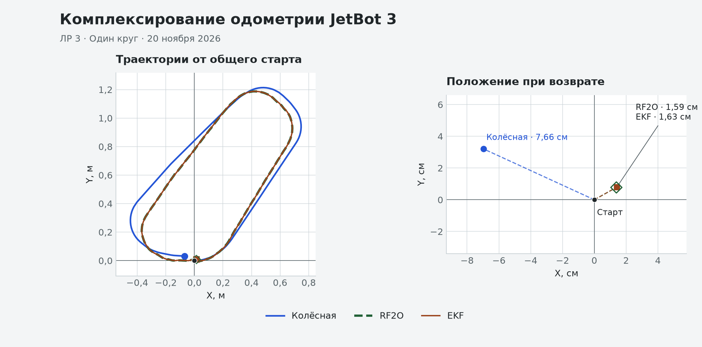
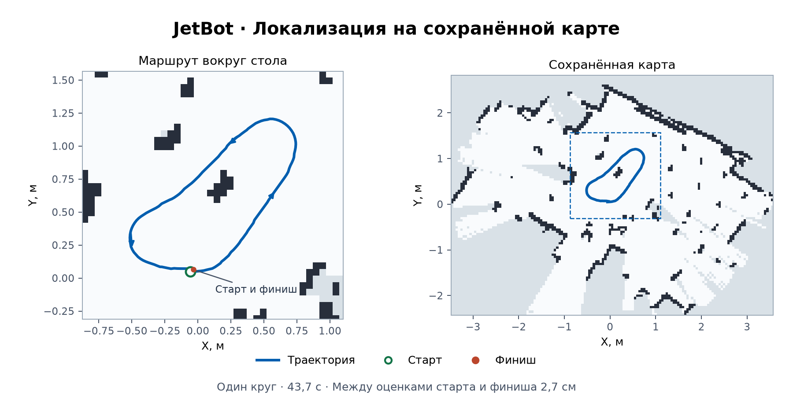

# JetBot ROS2 MIPT

A complete ROS2 implementation for JetBot differential drive robot with navigation capabilities, designed for educational and research purposes at MIPT.

## Overview

This project provides a full ROS2 stack for JetBot robots including:
- Hardware interface for differential drive control
- LIDAR integration (RPLidar)
- Navigation stack (Nav2)
- SLAM capabilities (slam_toolbox)
- Joystick control support
- Docker-based deployment

## Визуализации ЛР 3, ЛР 4 и ДЗ 2

[Код и инструкции курса](coursework/README.md)

### ЛР 3. Одометрия JetBot

Колёсная и лидарная одометрия и результат EKF на одном заезде. [Протокол ЛР 3](coursework/labs/lab03_odometry/results/04-ekf-odometry.md)



### ЛР 4. Локализация на сохранённой карте

Траектория JetBot при повторном объезде стола поверх карты первого заезда. [Протокол ЛР 4](coursework/labs/lab04_mapping/results/03-localization.md)



### ДЗ 2. Построение карты из rosbag

Ускоренное воспроизведение сохранённых состояний SLAM из 90-секундного фрагмента записи Scout. [Итоговая карта и протокол ДЗ 2](coursework/homework/hw02_slam/results/02-full-first-segment.md)


## Prerequisites

- NVIDIA Jetson platform (tested on Jetson Nano)
- Docker with NVIDIA runtime support
- ROS2 Humble (via Docker)
- Connected hardware:
  - JetBot motors via `/dev/ttyMOTOR`
  - RPLidar via `/dev/ttyLIDAR`
  - USB camera via `/dev/video0`
  - Gamepad controller via `/dev/input/js0`

## Hardware Setup

### USB Device Mapping (Required)
Before running the Docker containers, you need to set up consistent device names for your hardware. It should be done only ones:

```bash
# Run on the JetBot host system (NOT inside Docker)
cd general_scripts
sudo ./create_udev_rules.sh
```

This script:
- Creates symbolic links for USB devices with consistent names
- Maps motor controller (CH340 chip) to `/dev/ttyMOTOR`
- Maps RPLidar (CP210x chip) to `/dev/ttyLIDAR`
- Automatically detects devices by USB vendor/product IDs

**Device mapping details:**
- **Motors**: `ATTRS{idVendor}=="1a86", ATTRS{idProduct}=="7522"` → `/dev/ttyMOTOR`
- **LIDAR**: `ATTRS{idVendor}=="10c4", ATTRS{idProduct}=="ea60"` → `/dev/ttyLIDAR`

After running the script, verify device availability:
```bash
ls -la /dev/tty{MOTOR,LIDAR}
```

## Docker Architecture

This project uses a two-stage Docker build process:

### 1. Base Image (`docker_configs/Dockerfile_base`)
- **Purpose**: Contains general-purpose ROS2 packages and dependencies
- **Contents**: ROS2 Humble core, Navigation2, RViz2, RQT tools, build tools
- **Build location**: Recommended to build on powerful AMD64 host machine
- **Usage**: Foundation for all JetBot applications

### 2. Application Image (`Dockerfile`)
- **Purpose**: Adds specific packages for JetBot functionality
- **Contents**: Additional ROS2 packages (xacro, twist_mux, joystick drivers, etc.)
- **Build location**: Can be built on JetBot or host machine
- **Usage**: Ready-to-run JetBot container

## Quick Start

### 1. Hardware Setup
```bash
# Set up device mapping (run on JetBot host)
cd general_scripts
sudo ./create_udev_rules.sh

# Verify devices are accessible
ls -la /dev/tty{MOTOR,LIDAR}
```

### 2. Building the Project

#### Option A: Complete Local Build (on JetBot)
```bash
# Clone the repository
git clone <repository-url>
cd jetbot_ros2_mipt

# Build the application Docker image (includes base build)
docker build -t jetbot_full_ros2 .

# Start the container
docker-compose up -d
docker exec -it --privileged jetbot_ros2_mipt-jetbot-1 bash

# Build your packages (first time)
cd ~/ros2_ws
colcon build --symlink-install
```

#### Option B: Cross-compilation (Recommended)
**Step 1: Build base image on host machine (AMD64)**
```bash
# Navigate to docker configs
cd docker_configs

# Build base image and save as tar (for transfer to JetBot)
./build_for_amd.sh tar jetbot_ros2_base.tar

# Or build and push to Docker Hub
./build_for_amd.sh push v1.0.0
```

**Step 2: Transfer to JetBot and build application**
```bash
# Transfer tar to JetBot
scp jetbot_ros2_base.tar jetbot@<jetbot-ip>:~

# On JetBot: Load base image and build application
docker load < jetbot_ros2_base.tar
docker build -t jetbot_full_ros2 .
```

### 3. Building Your ROS2 Packages

#### Initial setup
```bash
# Start the container
docker-compose up -d

# Enter the container
docker exec -it --privileged jetbot_ros2_mipt-jetbot-1 bash
```

#### Build commands
```bash
# Build all packages
cd ~/ros2_ws
colcon build --symlink-install

# Build specific package
colcon build --packages-select diffdrive_jetbot

# Build with parallel jobs (adjust number based on your system)
colcon build --symlink-install --parallel-workers 2

# Source the workspace
source install/setup.bash
```

#### Development workflow
```bash
# After making changes to source code
colcon build --packages-select <package_name>
source install/setup.bash

# For fast iteration (only builds changed packages)
colcon build --symlink-install --packages-up-to <package_name>
```

## Usage

### Launch All Sensors and Drivers
Start all hardware drivers including motors, LIDAR, and joystick control:
```bash
ros2 launch jetbot_bringup activate_all_drivers.launch.py
```

This launches:
- Motor controllers (diffdrive_jetbot)
- RPLidar driver
- Joystick input handling
- Twist multiplexer for command prioritization

### SLAM Mapping
Create a map of the environment:
```bash
ros2 launch jetbot_bringup mapping.launch.py
```

This starts:
- slam_toolbox in online async mode
- Real-time map building from LIDAR data

### Navigation
Navigate using the created map:
```bash
ros2 launch jetbot_bringup nav2_bringup.launch.py
```

Launches the full Nav2 stack:
- Path planning
- Obstacle avoidance
- Goal-based navigation

### Localization (with existing map)
For localization against a pre-built map:
```bash
ros2 launch jetbot_bringup localization.launch.py
```

### PID Controller Tuning
This project includes a standalone interactive tool for tuning the motor PID controllers. This is crucial for achieving stable and responsive robot movement.

**Important**: The PID parameters are stored directly in the motor controller's flash memory. They are **not** configured through ROS parameters or URDF files. The `pid_tune` utility is the only supported method for setting these values.

**1. Build the Tuning Tool**

The tool is not part of the main `colcon` build. You need to compile it manually inside the container.

```bash
# Enter the container
docker exec -it --privileged jetbot_ros2_mipt-jetbot-1 bash

# Navigate to the tuning scripts directory
cd ~/ros2_ws/src/diffdrive_jetbot/tune_scripts

# Compile the tool
g++ -I../hardware/include/diffdrive_jetbot -o pid_tune pid_tune.cpp -lserial -lpthread
```

**2. Run the Tuning Tool**

Once compiled, run the tool from the same directory:
```bash
./pid_tune
```

**3. The Tuning Process**

The tool guides you through an interactive process:
1.  **Initial Parameters**: It will first ask for "ultimate gain" (Ku) and "ultimate period" (Tu) to calculate initial PID values using the Ziegler-Nichols method. You can find these by manually testing different `Kp` values (with `Ki` and `Kd` at zero) until the motors oscillate, or you can just provide a starting guess.
2.  **Interactive Loop**: You will enter a menu with the following options:
    - `[t] Test current PID values`: This is the main step. The tool will apply the PID values, which requires you to **manually reboot the motor controller**. After rebooting and pressing Enter, it runs a series of speed tests and gives you a performance score (lower is better).
    - `[m] Manually enter new PID values`: Allows you to adjust Kp, Ki, and Kd to try and improve the score.
    - `[s] Save best values and exit`: When you are satisfied with the performance, this option will apply the best-found PID values to the controller and exit.
3.  **Results**: After exiting, the tool will have generated:
    - A `.csv` file with raw data from the tests.
    - A `.txt` report with performance analysis.
    - A command to run `plots.py` to visualize the test data graphically.

## General Scripts

### Hardware Setup Scripts
Located in `general_scripts/`:

- **`create_udev_rules.sh`**: Sets up USB device symbolic links (run on host system)
  ```bash
  # Must be run on JetBot host (outside Docker)
  sudo ./create_udev_rules.sh
  ```
  Creates consistent device names:
  - Motor controller → `/dev/ttyMOTOR`
  - RPLidar → `/dev/ttyLIDAR`

### Docker Build Scripts
Located in `docker_configs/`:

- **`build_for_amd.sh`**: Cross-compilation script for building ARM64 base images on AMD64 machines
  ```bash
  # Save as tar file
  ./build_for_amd.sh tar jetbot_ros2_base.tar
  
  # Push to Docker registry
  ./build_for_amd.sh push v1.0.0
  ```

- **`find_ros_packages.py`**: Helper script to find ROS packages by prefix during base image build
- **`filter_rosinstall.py`**: Filters out already installed packages from rosinstall files to avoid conflicts

### Robot Control
- **Joystick Control**: Use connected gamepad for manual control
- **Twist Commands**: Send velocity commands via `/cmd_vel` topic
- **Multiple Input Sources**: Automatic switching between joystick, navigation, and manual control

## Architecture

### Packages

1. **`jetbot_bringup`**: Main launch package
   - Launch files for different operation modes
   - Configuration files for all components

2. **`diffdrive_jetbot`**: Hardware interface package
   - ROS2 Control hardware interface
   - Serial communication with motor controller
   - Wheel odometry and velocity control

### Hardware Communication
- **Motors**: Serial protocol via `/dev/ttyMOTOR` at 115200 baud
- **LIDAR**: RPLidar A1/A2 via `/dev/ttyLIDAR`
- **Camera**: USB camera for future vision applications

### Control Flow
```
Joystick/Nav2 → twist_mux → diff_drive_controller → Hardware Interface → Motors
                    ↑
LIDAR → slam_toolbox/nav2 → Local/Global Planning
```

## Docker Images Explained

### Base Docker Image (`docker_configs/Dockerfile_base`)
Contains general-purpose ROS2 components:
- ROS2 Humble core packages
- Navigation2 complete stack
- RQT tools suite and RViz2
- SLAM Toolbox
- ROS2 Control framework
- Build tools and dependencies

**Why build on host machine?**
- Faster compilation on powerful AMD64 hardware
- Reduced thermal load on JetBot
- Consistent build environment
- Can be reused across multiple JetBot projects

### Application Docker Image (`Dockerfile`)
Adds JetBot-specific packages:
- Additional teleop and control packages
- Joystick drivers
- Robot-specific utilities
- Your custom packages (src/ directory)

**Build considerations:**
- Lighter build process (fewer packages)
- Can be built on JetBot if needed
- Contains application-specific configurations

## Configuration

### Motor Parameters
Configure in `diffdrive_jetbot/description/ros2_control/diffbot.ros2_control.xacro`:
- `mtype`, `mline`, `mphase`: Motor encoder settings.
- `deadzone`: Motor deadzone value.
- `wdiameter`: Wheel diameter in millimeters.
- `max_motor_rpm`: Maximum motor speed for scaling velocity commands.

### Navigation Tuning
Edit `config/nav2_default_params.yaml` for:
- Path planning parameters
- Obstacle avoidance settings
- Controller tuning

## Troubleshooting

### Common Issues
1. **Device permissions**: 
   - Ensure udev rules are properly installed: `sudo ./general_scripts/create_udev_rules.sh`
   - Check device availability: `ls -la /dev/tty{MOTOR,LIDAR}`
   - Verify USB connections and device IDs: `lsusb`

2. **ROS_DOMAIN_ID**: Set consistent domain ID across all nodes
3. **Transform errors**: Check that all required transforms are published
4. **Build failures**: Check available memory (use fewer parallel workers if needed)

### Debugging
```bash
# Check hardware interfaces
ros2 control list_hardware_interfaces

# Monitor controller status
ros2 control list_controllers

# View topics and transforms
ros2 topic list
ros2 run tf2_tools view_frames

# Check build logs
colcon build --event-handlers console_direct+

# Test motor communication (inside container)
cd ~/ros2_ws/src/diffdrive_jetbot/hardware
g++ -o test_motor_comms test_motor_comms.cpp -lserial
./test_motor_comms
```

## Contributing

1. Fork the repository
2. Create a feature branch
3. Test on actual hardware
4. Submit a pull request

## License

[Add your license information here]

## Acknowledgments

- Based on ROS2 Control framework
- Uses Navigation2 for autonomous navigation
- SLAM implementation via slam_toolbox
