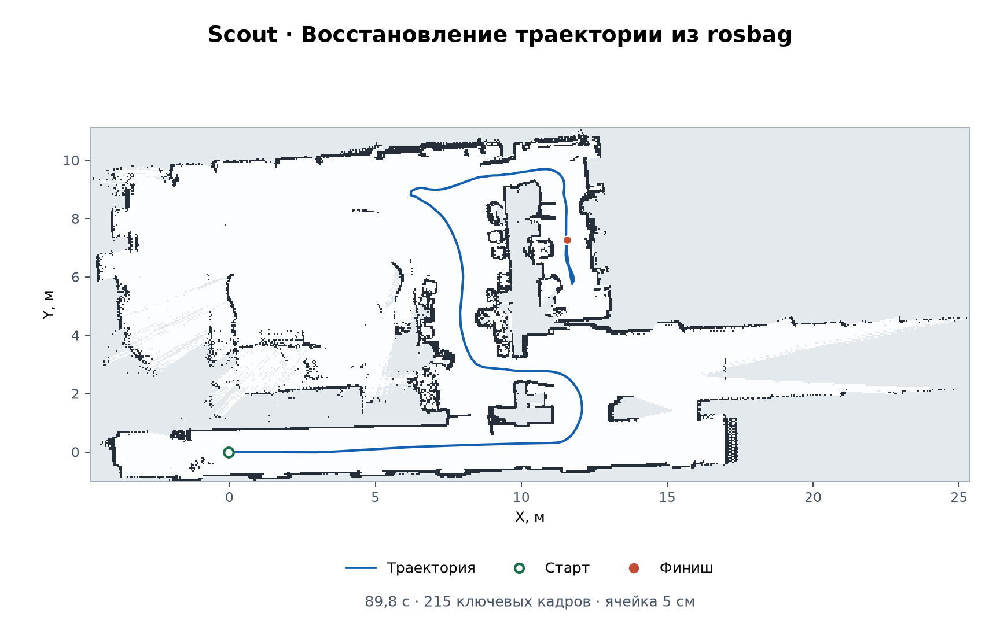

# ДЗ 2. Полный прогон первого фрагмента

20 ноября 2026 года на Mac воспроизведён исходный `2018-01-28-19-15-41_0` в ROS 2 Jazzy на скорости 1×. Длительность записи 89,811 с. В бэге 898 сообщений колёсной одометрии, 898 облаков лидара и 2 692 кадра с камеры. Процесс воспроизведения завершился штатно.

| Показатель | Значение |
| --- | ---: |
| Размер сетки занятости | 603 × 243 ячейки |
| Разрешение | 5 см |
| Ключевые кадры траектории | 215 |
| Длина ломаной по ключевым кадрам | 34,67 м |
| Ключевые кадры в свободных ячейках | 215 из 215 |

На карте видны непрерывные участки основных стен и проход вокруг центральных препятствий. Возле отдельных препятствий и на границах обзора остаются неровные контуры и разрозненные отметки. Траектория проходит по свободным ячейкам карты. Истинная траектория для сверки в бэге не задана, поэтому эта проверка описывает согласованность карты и пути на первом фрагменте.

[Координаты ключевых кадров в CSV](02-full-first-segment.csv).

Для браузерной демки сохранены 62 различных состояния сетки занятости, 449 прореженных облаков лидара и видео камеры длительностью около 90 с. При перемотке выбирается последнее состояние карты и облака на заданный момент. Чекбокс траектории и полноэкранный режим доступны в самой демке.

При отдельном живом прогоне в RViz подтверждены подписки на `/map` и `/slam_path`. В журнале RViz виден рост карты до 603 × 243 ячеек.
