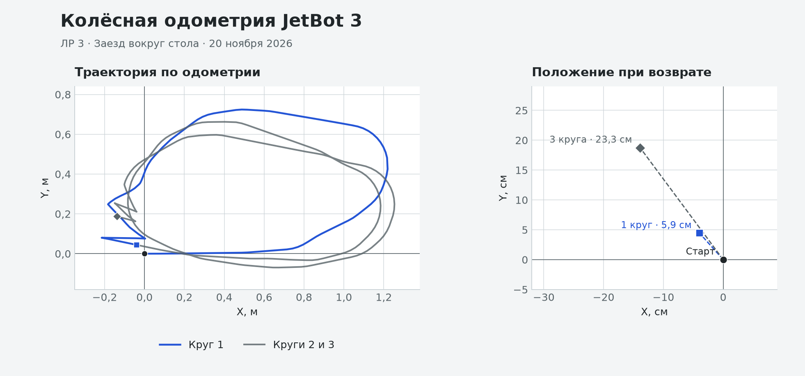

# ЛР 3. Колёсная одометрия

20 ноября 2026 года. JetBot `jetbotj3`. Оператор установил робота на пол в точке старта. Для сброса одометрии перезапущен `ros2 launch jetbot_bringup activate_all_drivers.launch.py` в рабочем контейнере.

Начальная и обе конечные позы сняты с `/diffbot_base_controller/odom` в системе `odom` для `base_footprint`.

```bash
./dockers/scripts/ros.sh ros2 topic echo /diffbot_base_controller/odom \
  nav_msgs/msg/Odometry --once --no-daemon --spin-time 2 --field pose.pose
```

| Замер | X, м | Y, м | Курс, ° | Отклонение от старта, м |
| --- | ---: | ---: | ---: | ---: |
| Старт после сброса | 0,000 | 0,000 | 0,0 | 0,000 |
| Возврат после 1 круга | −0,039 | +0,044 | −12,0 | 0,059 |
| Возврат после 3 кругов | −0,139 | +0,187 | −20,5 | 0,233 |

Все три позы сверены с пультом на Mac. После первого круга оператор подтвердил возврат на метку. Ещё два круга выполнены без сброса одометрии. Расстояние от начала координат выросло с 5,9 до 23,3 см, примерно в 3,9 раза. Курс сместился с −12,0° до −20,5°.

По этому заезду видно, что расхождение колесной одометрии со стартом накопилось. Точность попадания на метку и фактический угол возврата отдельно не измерялись, поэтому значения характеризуют расхождение в данном заезде.



Интервал опроса пульта около 0,2 с. В CSV записаны начальный отсчёт и изменения одометрии. [Первый круг, 201 отсчёт](02-wheel-trajectory-1-lap.csv) · [Все три круга, 465 отсчётов](02-wheel-trajectory-3-laps.csv).
