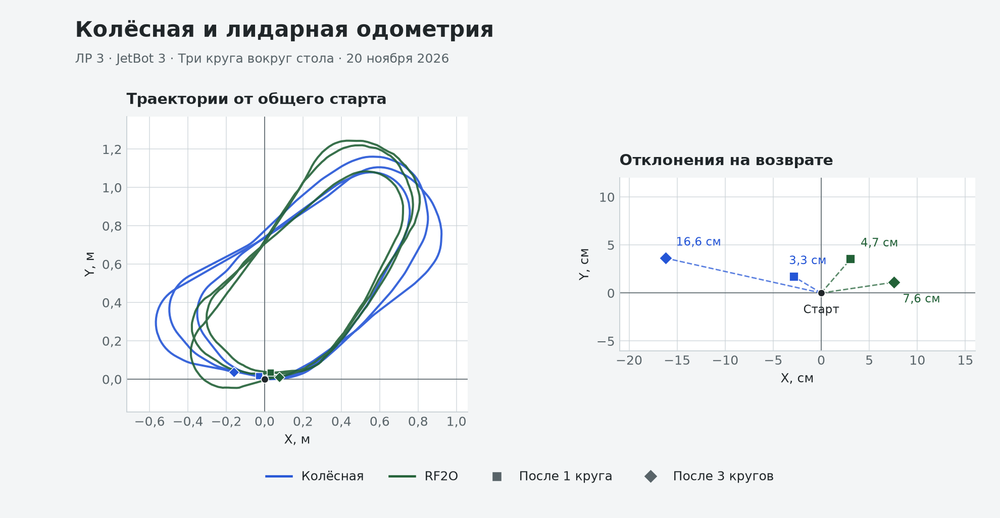

# ЛР 3. Лидарная одометрия RF2O

20 ноября 2026 года. JetBot `jetbotj3`. Для проверки запуска робот стоял на столе на зарядке. Управление в пульте было выключено.

- В рабочем ROS 2 Humble собран пакет `rf2o_laser_odometry`, ветка `ros2`, коммит `b38c68e46387b98845ecbfeb6660292f967a00d3`. Запущен [launch для JetBot](../jetbot_lab03_rf2o.launch.py).
- На JetBot получено сообщение `/scan` с фреймом `lidar_link` и подтверждён TF `base_footprint → lidar_link`. В одном скане было 1080 лучей, из них 402 попадания в радиусе 2 м. Количество попаданий меняется от кадра к кадру.
- `/odom_rf2o` публикует позу `base_footprint` в `lidar_odom`. В работающем узле `publish_tf = false`.
- За пять секунд подписки получено 29 сообщений RF2O и 164 сообщения колёсной одометрии. В `/tf` наблюдался `odom → base_footprint`, а трансформов от `lidar_odom` не было.
- В Safari проверена вкладка **Лидарная**. Сверху обновлялись точки скана, снизу — показания и траектория RF2O.

## Заезд на полу

Оператор поставил JetBot на стартовую метку. Перезапущены драйверы, проверены свежий скан и его TF, затем перезапущен RF2O. Запись с пульта начата в 17:39:33 по Москве с интервалом опроса около 0,2 с.

| Источник | X при старте записи, м | Y при старте записи, м | Курс, ° |
| --- | ---: | ---: | ---: |
| Колёсная | 0,0000 | 0,0000 | 0,000 |
| RF2O | +0,0025 | +0,0026 | −0,235 |

### Возврат после первого круга

Замер в 17:41:57 по Москве. Взята первая точка остановки, с которой колёсная поза стабилизировалась, а управление и команды скорости были выключены.

| Источник | X, м | Y, м | Курс, ° | Расстояние от старта, см | Изменение курса, ° |
| --- | ---: | ---: | ---: | ---: | ---: |
| Колёсная | −0,0284 | +0,0169 | −10,12 | 3,30 | −10,12 |
| RF2O | +0,0331 | +0,0377 | −3,52 | 4,66 | −3,29 |

Отсчёт для каждого источника сделан от его позы на старте записи. За время ожидания перед движением RF2O уже накопил 1,50 см смещения. [Совместная траектория первого круга, 699 отсчётов](03-wheel-rf2o-trajectory-1-lap.csv).

### Возврат после третьего круга

Замер в 17:44:52 по Москве после ещё двух кругов. Одометрия между отметками не сбрасывалась. Применён тот же критерий остановки и тот же стартовый отсчёт.

| Источник | X, м | Y, м | Курс, ° | Расстояние от старта, см | Изменение курса, ° |
| --- | ---: | ---: | ---: | ---: | ---: |
| Колёсная | −0,1617 | +0,0362 | −16,44 | 16,57 | −16,44 |
| RF2O | +0,0781 | +0,0135 | +9,35 | 7,64 | +9,59 |

После первого круга колёсная одометрия показала меньшее отклонение по позиции, 3,30 см против 4,66 см. После трёх кругов позиция RF2O оказалась примерно в 2,2 раза ближе к старту, 7,64 см против 16,57 см. Модуль отклонения курса у RF2O был меньше в обеих контрольных точках. Физическое положение и ориентацию при возврате независимо не измеряли. Сравнение относится к одному заезду.

На графике обе траектории приведены к собственным стартовым положению и курсу. В CSV сохранены исходные координаты и команды скорости. [Совместная траектория трёх кругов, 1547 отсчётов](03-wheel-rf2o-trajectory-3-laps.csv).
