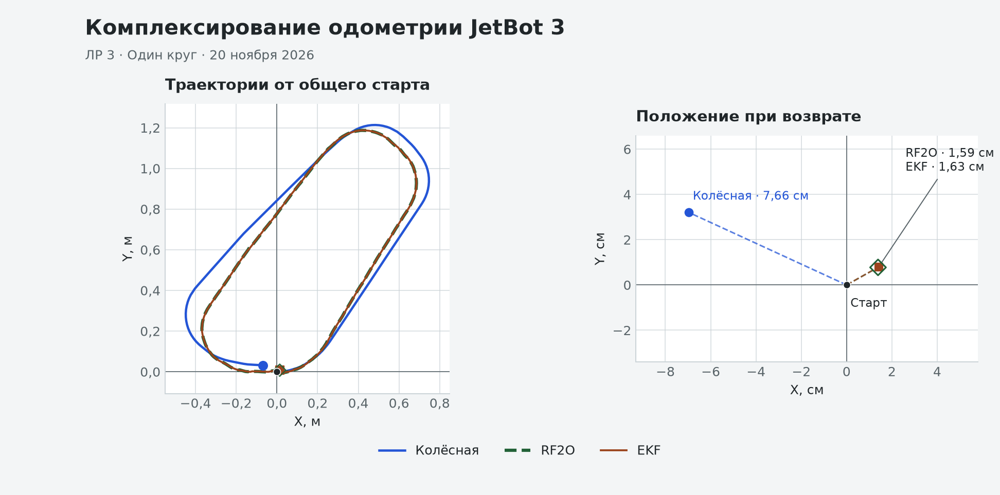

# ЛР 3. Комплексирование одометрии

20 ноября 2026 года. JetBot `jetbotj3`, ROS 2 Humble. Для проверки робот стоял на столе. Управление оставалось выключенным.

Конфигурация [ekf_jetbot.yaml](../params/ekf_jetbot.yaml) использует продольную и боковую скорости, а также скорость поворота колёсной базы. От RF2O поступают X, Y и курс. Адаптер задаёт для RF2O начальные стандартные отклонения 5 см по X/Y и 5° по курсу. Эти величины выбраны для первого прогона, измеренной калибровки для них пока нет.

## Проверка фильтра

Запущен [учебный launch](../jetbot_lab03_ekf.launch.py) с искусственными сообщениями одометрии в изолированном ROS-домене. Первый отсчёт RF2O с ненулевой позой дал нулевую относительную позу фильтра. Подача только колёсных скоростей 0,16 м/с и 0,20 рад/с изменила X фильтра до 0,283 м и курс до 0,347 рад. Затем RF2O вывел оценку к заданной относительной позе X = 0,55 м, Y = 0,25 м, курс = 0,35 рад. За тест получено 82 сообщения фильтра. Динамические TF в тестовом домене отсутствовали.

## Проверка на JetBot

За семь секунд подписки в рабочем домене получено 408 сообщений колёсной одометрии, 53 сообщения RF2O, 53 сообщения адаптера и 114 сообщений EKF. Подтверждена ожидаемая ковариация на входе фильтра. В `/tf` сохранилась пара `odom → base_footprint`, а трансформаций от `ekf_odom` не было.

В Safari проверена вкладка **EKF**. На общем графике доступны три источника и расстояние от их стартовых позиций.

## Заезд на полу

После установки робота на метку последовательно перезапущены драйверы, RF2O и EKF. Запись трёх потоков началась в 18:20:49 по Москве. Интервал опроса пульта около 0,2 с.

| Источник | X при старте записи, м | Y при старте записи, м | Курс, ° |
| --- | ---: | ---: | ---: |
| Колёсная | 0,0000 | 0,0000 | 0,0000 |
| RF2O | −0,0013 | −0,0007 | +0,2789 |
| EKF | 0,0000 | 0,0000 | 0,0000 |

До движения проверены все три относительных нуля в пульте, включая отдельную вкладку RF2O. Прежняя запись содержала только ожидание. С 18:26:29 по Москве начата новая запись. Для итогового сравнения используем исходные позы `start.reference`, которые пульт фиксирует при первой ненулевой команде движения. Так дрейф во время ожидания на метке остаётся за пределами заезда.

### Возврат после одного круга

Старт зафиксирован в 18:28:56,658 по Москве. Поза возврата взята в 18:29:38,075, в первом отсчёте устойчивой остановки с выключенным управлением и нулевой командой. Между этими точками прошло 41,4 с. Координаты и курс приведены к начальному положению и направлению каждого источника.

| Источник | ΔX, см | ΔY, см | Δ курса, ° | Расстояние от старта, см |
| --- | ---: | ---: | ---: | ---: |
| Колёсная | −6,96 | +3,20 | −3,04 | 7,66 |
| RF2O | +1,39 | +0,78 | +6,41 | 1,59 |
| EKF | +1,42 | +0,80 | +6,44 | 1,63 |

По позиции EKF показал отклонение в 4,7 раза меньше колёсной оценки. RF2O и EKF отличались по этому показателю примерно на 0,4 мм. По курсу ближе к стартовому значению оказалась колёсная одометрия. Фактическую позу на метке независимо не измеряли, поэтому вывод относится к расхождению оценок в этом заезде.

[CSV заезда, 202 отсчёта](04-ekf-three-trajectory-1-lap.csv) · [Исходные позы из пульта](04-ekf-start-reference.json).
