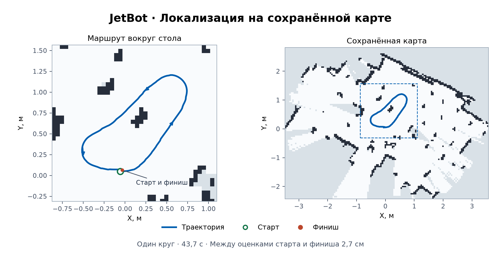

# ЛР 4. Заезд в режиме локализации

20 ноября 2026 года. JetBot `jetbotj3`. После остановки узла картирования запущен `localization_launch.py`. Узел загрузил граф и сканы из [первого заезда](02-first-lap/README.md), подписался на лидарный `/scan` и публиковал позу в системе `map`. При запуске начальная поза была задана из конечной оценки первого круга.

Пользователь повторил круг вокруг стола и вернулся к стартовой отметке. Из потока позы в пульте выделены отсчёты с 18:59:11,494 до 18:59:55,187 по Москве. Границы заезда взяты по началу и окончанию изменения оценки позы. Между ними прошло 43,7 с, получено 172 отсчёта. После остановки в пульте подтверждены нулевая команда движения и доступная поза.

| Показатель | Старт | Финиш |
| --- | ---: | ---: |
| X, м | −0,0570 | −0,0355 |
| Y, м | 0,0484 | 0,0642 |
| Курс, ° | 2,69 | −1,28 |

Траектория прошла вокруг стола и вернулась к стартовой области. Расхождение между оценками старта и финиша составило 2,7 см по позиции и 4,0° по курсу. Фактическое отклонение от отметки отдельно не измеряли.

[Траектория в CSV](03-localization-trajectory.csv).
